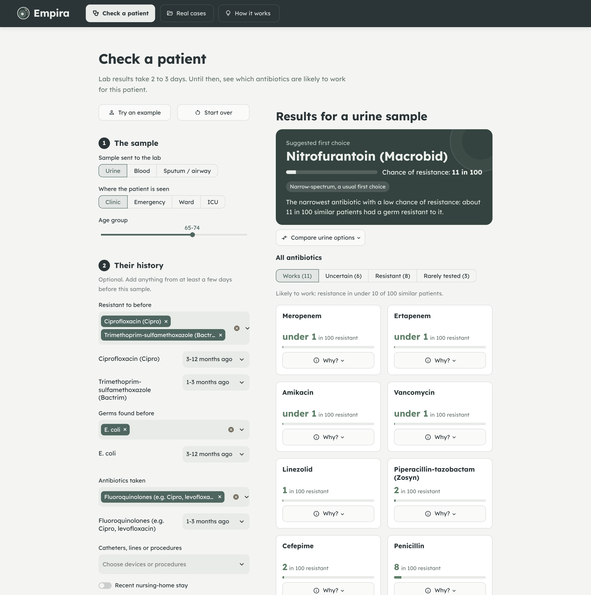

<p align="center"></p>

# Empira: antibiotic resistance prediction at culture order

When a urine, blood or respiratory culture is sent, the lab needs 2–3 days to report which antibiotics work, so the first antibiotic is chosen blind. Empira predicts, **at the moment the culture is ordered and from the patient's record alone**, the chance that the germ is resistant to each of 28 antibiotics. For urine samples it also suggests the narrowest antibiotic with a low enough risk.

It was trained and evaluated on the public ARMD-Stanford dataset and ships as a sealed model (v1.0), a FastAPI backend and a Streamlit app.

> **Research prototype. Not a medical device and not for clinical use.**



## Results (test set 2022 – Jan 2024, never used for any choice)

| | |
| --- | --- |
| Mean AUROC, 28 antibiotics | **0.780** (95% CI 0.772–0.787) |
| Mean AUROC, 10 most-tested antibiotics | 0.761 (hospital antibiogram 0.547, prior-resistance rule 0.661) |
| Calibration | median ECE 0.012, median slope 0.98 |
| Urine decision analysis (n = 7,436) | wrong first choice 11.8% → **8.0%** at clinicians' second-line use, or second-line use 23.3% → **7.7%** at clinicians' error rate |

Details: [model card](models/MODEL_CARD.md), [technical reference](docs/TECHNICAL_REFERENCE.md), reports 01–07 in [`reports/`](reports/).

## Quick start

Python 3.10+.

```bash
pip install -r requirements.txt -r app/requirements.txt
```

**1. Get the data.** Download ARMD-Stanford from Dryad ([doi:10.5061/dryad.jq2bvq8kp](https://doi.org/10.5061/dryad.jq2bvq8kp)) and put the CSV files in `data/armd_stanford/` (see [`data/README.md`](data/README.md)). The data is not redistributed in this repository.

**2. Build features, predictions and checks** (about 10 minutes on a 4 GB, 2-core laptop):

```bash
python run_all.py              # rebuilds data/processed and data/predictions, runs the release checks
python run_all.py --list       # show the stages
python run_all.py --only test  # re-check the sealed release only
```

The sealed model files are already in `models/`. The default run retrains the two final components, which reproduces the sealed files exactly; the release checks verify this against `models/SHA256SUMS`. To run only the demo, step 2 needs just `python run_all.py --only features` followed by `python run_all.py --only final`, which also writes the predictions the real-case pages use.

**3. Run the demo:**

```bash
uvicorn app.backend.main:app --port 8000               # API, docs at http://localhost:8000/docs
cd app/frontend && streamlit run streamlit_app.py      # app at http://localhost:8501
```

Or `app/run_demo.sh` (macOS/Linux) and `app\run_demo.bat` (Windows). See [`app/README.md`](app/README.md).

**Tests:**

```bash
python tests/run_tests.py          # 10 release checks (checksums, leakage rules, split, exact reproduction, thresholds)
python -m pytest app/backend/tests # 11 API tests
```

## Repository layout

```
app/
  backend/               FastAPI service: main.py (routes), schemas.py, service.py, wording.py, tests/
  frontend/              Streamlit app: streamlit_app.py, ui.py, views/, static/ (Lexend font, brand assets)
  run_demo.sh / .bat     start API + app
data/                    not tracked; see data/README.md
  armd_stanford/         raw ARMD CSVs (download from Dryad)
  armd_mgb/              ARMD-MGB for external validation (PhysioNet, credentialed)
  processed/             leakage-safe features and labels (built by src/02)
  predictions/           validation/test predictions (built by src/04)
docs/
  TECHNICAL_REFERENCE.md architecture, data, pipeline, model, API reference, operations
  RESEARCH_BRIEF.md      data citations, burden statistics, prior work, competitors
  architecture.png       system diagram
  screenshots/           app screenshots and a walkthrough video
models/                  sealed v1.0 release: 28 per-antibiotic + 1 shared LightGBM, calibration,
                         manifest, SHA256SUMS, MODEL_CARD.md
reports/                 reports 01–07 with tables and figures for each phase
src/
  common.py              config, splits, feature assembly, metrics
  01_eda_leakage_audit.py  02_build_features.py  03_train_baseline.py
  04_experiments.py  04b_organism_probs.py  05_evaluate.py  06_decision_analysis.py
  07_explain.py  08_external_validate.py
  predictor.py           frozen model: predict + explain (TreeSHAP)
  demo_api.py            simple inputs → model features, urine first-choice policy
tests/                   release checks and the external-validation fixture
run_all.py               one entry point for the pipeline
RELEASE.md               what was sealed and how it was verified
release_code.sha256      checksums of the sealed pipeline code
```

## How it works

1. **Prediction time is the culture order.** Earlier results and organisms are used only if at least 3 days old; antibiotic courses and procedures at least 1 day old. The organism in today's sample, labs and vitals are never used.
2. **Model:** the average of 28 per-antibiotic LightGBM models and one shared model, recalibrated per antibiotic on 2021 data. 90 inputs: sample type, care setting, age band, the patient's earlier resistance, organisms, antibiotic courses and devices.
3. **Split by time:** train 2008–2020, choose everything on 2021, report on 2022 – Jan 2024.
4. **Explanations:** TreeSHAP contributions turned into plain sentences ("A germ from this patient was resistant to ciprofloxacin about 6 months ago").
5. **Urine first choice:** the narrowest of seven candidates whose predicted resistance is at or below 0.15 (fewer wrong choices) or 0.20 (narrower antibiotics). Both thresholds were fixed on 2021.

## Data and citation

Nateghi Haredasht F, Amrollahi F, Maddali M, et al., Chen J. *Antibiotic Resistance Microbiology Dataset (ARMD): A resource for antimicrobial resistance from EHRs.* Dryad, 2025. https://doi.org/10.5061/dryad.jq2bvq8kp. Data descriptor: *Scientific Data*, 2025. https://doi.org/10.1038/s41597-025-05649-7

## Limitations

Single health system, retrospective only. Weaker for blood cultures, emergency patients and people over 85. Performance drifts by about 0.015 AUROC a year, so calibration should be refreshed yearly. The decision analysis ignores allergies, kidney function, pregnancy and colonisation. External validation on ARMD-MGB is built (`src/08_external_validate.py`) and awaits data access.
