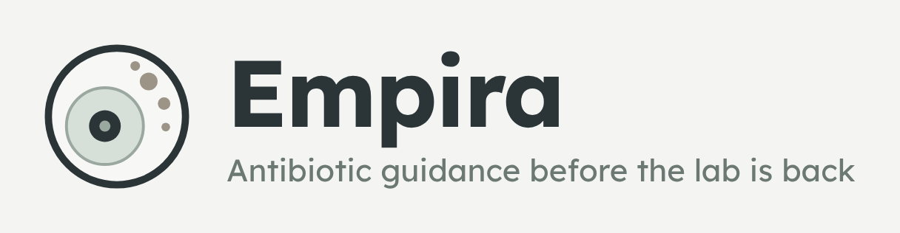
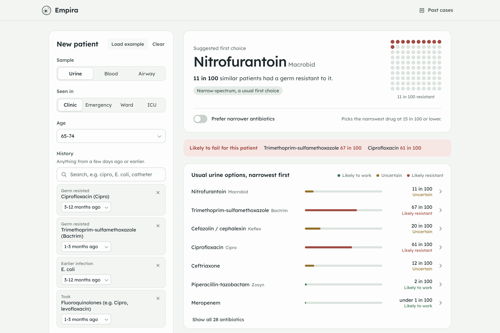

# Empira app



A FastAPI backend and a single-screen web app built on the sealed v1.0 model (`models/`, `src/predictor.py`, `src/demo_api.py`).
The model itself is untouched; the app only calls it.



The name comes from *empiric therapy*: choosing an antibiotic before the lab has identified the germ. Brand files: `web/assets/brand/`.

## Run it

From the project folder:

```
pip install -r requirements.txt -r app/requirements.txt
```

Then either:
- Windows: double-click `app\run_demo.bat`
- Mac/Linux: run `./app/run_demo.sh`

Or start the two parts yourself:

```
python -m uvicorn app.backend.main:app --port 8000               # the API, from the project folder
python -m http.server 8501 --bind 127.0.0.1 --directory app/web  # the web app (plain static files)
```

Then open the app at http://localhost:8501 (API docs: http://localhost:8000/docs). If the API runs elsewhere, open `http://localhost:8501/?api=http://host:port`.

Needed from the project:
- `models/`
- `data/processed/` (cultures, history, labels_agnostic, own_history_long, prior_resistance_long)
- `data/predictions/final_test.parquet` (for past cases)
- `reports/phaseB/bootstrap_summary.json`
- `reports/phaseC/decision_summary.json`

## The app

One screen. The patient is on the left; the answer on the right updates as you type, with no submit button.

- **Patient:** sample (urine, blood, airway), where they are seen, age, and their history. History is one search box: type "cipro", "E. coli" or "catheter" and press Enter; each item becomes a chip with its own "when". Arrow keys, Enter, Escape and Backspace work as expected. Answers are remembered in the browser.
- **Answer (urine):** the suggested first choice in large type, with a 100-dot picture of how many similar patients had a resistant germ. A switch prefers narrower antibiotics. Below it, any usual option that is likely to fail, then the seven usual urine options narrowest first. Any row opens to show the top reasons. "Show all 28 antibiotics" reveals the rest.
- **Answer (blood, airway):** no single suggestion (validated for urine only); the antibiotics with the lowest chance of resistance first.
- **Past cases** (top right): five real 2022–2024 cultures the model never saw, with the lab's actual result on every row, including one the model got wrong.
- **Phone:** the layout stacks, and a floating bar shows the current answer and jumps to it.

## Files

```
app/backend/            FastAPI service (main.py, service.py, schemas.py, wording.py, tests/)
app/web/
  index.html            the single screen
  styles.css            layout, colours, type; responsive and reduced-motion aware
  app.js                state, live API calls, history search, rendering (no framework, no build step)
  assets/               Lexend variable font (SIL OFL) and brand/ (logo files, favicon, brand board)
```

## API

| Method | Path | Returns |
| --- | --- | --- |
| GET | `/api/health` | Model loaded, number of antibiotics |
| GET | `/api/options` | Everything a form needs (sample types, settings, age groups, antibiotics, germs, antibiotic families, devices, "when" choices) |
| POST | `/api/predict` | Chance of resistance for 28 antibiotics with reasons, plus a suggested first choice for urine |
| GET | `/api/cases` | The real example cases |
| GET | `/api/cases/{case_id}` | Model estimates next to the lab's actual results |
| GET | `/api/model` | Plain-language accuracy, impact and limits |

Example:

```
curl -X POST http://localhost:8000/api/predict -H "Content-Type: application/json" -d "{\"specimen\":\"URINE\",\"setting\":\"Outpatient\",\"age_group\":\"65-74 years\",\"past_resistance\":[{\"antibiotic\":\"ciprofloxacin\",\"when\":\"3_12_months\"}]}"
```

Input rules:
- `when` is one of `last_month`, `1_3_months`, `3_12_months`, `1_2_years`, `over_2_years`.
- `choice_mode` is `balanced` (threshold 0.15) or `stewardship` (0.20). These are the two thresholds validated in report 05; a test fails if they ever drift.
- Unknown values return a 422 that names the field.

## Tests

```
python -m pytest app/backend/tests -q        # 11 tests
```

They check that:
- the API's probabilities equal the sealed model's, for both form input and real test cultures;
- prior resistance raises risk;
- nitrofurantoin is never offered to inpatients;
- blood samples get no single suggestion;
- bad input is rejected.

## Design notes

- **One decision per screen:** the suggested antibiotic is the only large element; everything else is secondary and collapsed until asked for.
- **Natural frequencies:** "11 in 100" and a 100-dot picture instead of probabilities, a standard in risk communication.
- **Colour never carries meaning alone:** every bar has its words ("Likely resistant"); bands are under 10 in 100 = likely to work, 10–30 = uncertain, 30 or more = likely resistant.
- **Accessible:** keyboard-operable segmented controls and search (ARIA radio group and combobox), visible focus, live region for results, reduced motion respected.
- **Rarely tested drugs** (under 5% of cultures of that sample type) are marked as less certain.
- **Typeface:** Lexend (variable), bundled under the SIL Open Font License so it works offline. **Palette:** slate `#1E292C`, sage `#4F6660`, mist `#F3F5F3`; verdict colours `#3F7452`, `#94702A`, `#A14B43`.

Research prototype. Not for clinical use.
