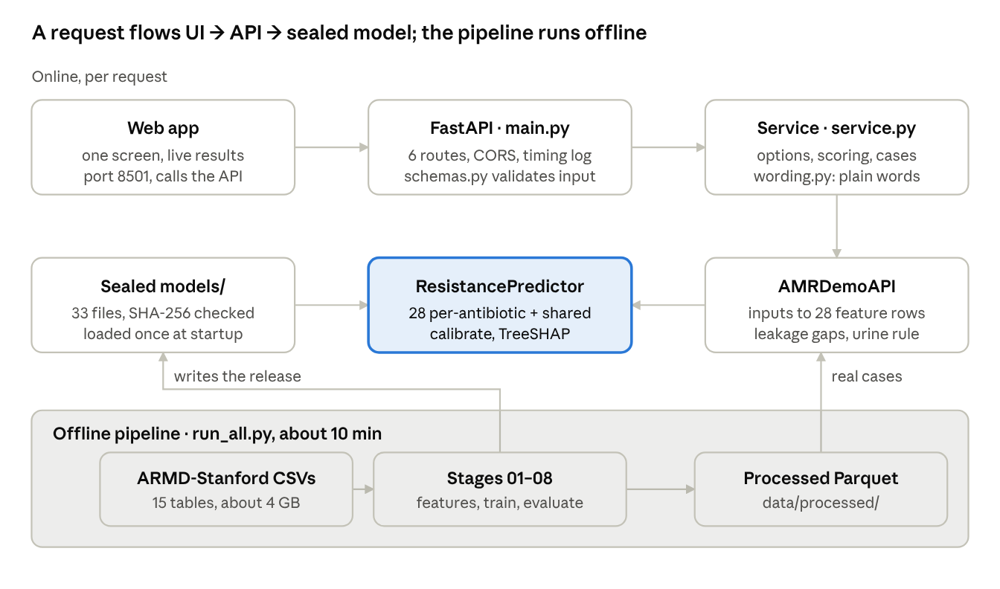

# Empira Technical Reference

Version 1.0 · October 2026

Empira v1.0 estimates, at the moment a urine, blood or respiratory culture is ordered, the chance that the germ will be resistant to each of 28 antibiotics, and suggests the narrowest safe first choice for urine. This reference covers the system end to end: data, pipeline, model, API, backend logic, frontend, operations and limits. Research prototype; not for clinical use.

## Architecture



The UI sends JSON to the FastAPI service, which validates it, builds 28 feature rows through `AMRDemoAPI` and scores them with the frozen `ResistancePredictor`; nothing online writes to disk. The offline pipeline turns the ARMD CSVs into Parquet tables and the sealed model files once.

## Data source

Empira is trained only on ARMD-Stanford, a public, de-identified EHR extract of adult microbiology cultures at Stanford Health Care. It is cited as: Nateghi Haredasht F, Amrollahi F, Maddali M, et al., Chen JH. *Antibiotic Resistance Microbiology Dataset (ARMD): A resource for antimicrobial resistance from EHRs.* Dryad, 2025. [doi:10.5061/dryad.jq2bvq8kp](https://doi.org/10.5061/dryad.jq2bvq8kp). Data descriptor: *Scientific Data*, 2025, [doi:10.1038/s41597-025-05649-7](https://doi.org/10.1038/s41597-025-05649-7).

| Scope | Full dataset | Empira modelling set |
| --- | --- | --- |
| Patients | 283,715 | 67,007 |
| Cultures | 751,075 (urine 375,177 · blood 291,365 · respiratory 84,533) | 118,748 positive cultures with results (urine 89,299 · respiratory 16,736 · blood 12,713) |
| Years | Dec 1999 – Feb 2024 (dates jittered) | 2008 – Jan 2024 |
| Antibiotics tested | 55 | 28 (those with at least 10,000 labels) |
| Labelled results | 1,601,980 culture × organism × antibiotic pairs, 16.6% resistant | 1.47M culture × antibiotic rows |

**Tables used.** The project downloaded 15 CSV tables (about 4 GB; the comorbidity table was not used). Each row is keyed by an anonymised patient id (`anon_id`) and a culture order id (`order_proc_id_coded`).

| Table | What it holds | How Empira uses it |
| --- | --- | --- |
| `microbiology_cultures_cohort` | Culture type, organism, antibiotic, susceptibility (S/I/R) | Labels; rebuilds each patient's own earlier results |
| `microbiology_cultures_demographics` | Age band, anonymised sex code | Features |
| `microbiology_cultures_ward_info` | Inpatient / outpatient / ER / ICU flags | Features |
| `microbiology_cultures_adi_scores` | Area Deprivation Index | Features |
| `microbiology_cultures_nursing_home_visits` | Nursing-home contact | Feature |
| `microbiology_cultures_microbial_resistance` | Earlier resistant results, days before the order | Features (gap of 3 days or more) |
| `microbiology_culture_prior_infecting_organism` | Earlier organisms, days before the order | Features (gap of 3 days or more) |
| `microbiology_cultures_antibiotic_class_exposure` | Earlier antibiotic courses by class | Features (gap of 1 day or more) |
| `microbiology_cultures_priorprocedures` | Catheters, central lines, dialysis, ventilation, surgery | Features (gap of 1 day or more) |
| `microbiology_cultures_prior_med` | Medications with start day | Day-0 rows only, to find what clinicians prescribed (decision analysis) |
| `microbiology_cultures_labs`, `_vitals` | 14-day lab and vital-sign summaries | Not used: window direction undocumented, no gain on validation |
| `microbiology_cultures_implied_susceptibility` (+ rules) | Results implied from other drugs | Not used as features (label-side only) |
| `microbiology_cultures_antibiotic_subtype_exposure` | Same as class table at finer grain | Not used (duplicate) |

**Split by time, never by row.** Train 2008–2020 (87,745 cultures, 50,917 patients, 1,013,479 rows), validate 2021 (9,765 cultures, 140,359 rows), test 2022–Jan 2024 (21,238 cultures, 15,210 patients, 317,134 rows). The 2022–2024 test set was used for nothing but final reporting.

A companion dataset from Mass General Brigham (ARMD-MGB, on PhysioNet, credentialed access) has the same format; the external-validation pipeline is built for it but the data has not been obtained yet.

## Data storage

v1.0 has no database: everything is versioned files, and the running service only reads them. Raw CSVs are turned into Parquet tables once by the pipeline; the API loads the sealed model files at startup and reads two processed tables to build real-case views.

| Layer | Location | Contents | Size / rows |
| --- | --- | --- | --- |
| Raw | `data/armd_stanford/*.csv` | The 15 ARMD tables, as downloaded (not redistributed) | about 4 GB |
| Processed | `data/processed/cultures.parquet` | One row per positive culture: specimen, setting flags, age, sex code, ADI, nursing home, year | 118,748 × 16 |
|  | `history.parquet` | One row per culture: days since each earlier resistance, organism, antibiotic class and procedure, plus counts | 118,748 × 74 |
|  | `labels_agnostic.parquet` | Culture × antibiotic label: `R` (resistant) and `NS` (non-susceptible), worst result across organisms | 1,503,508 × 4 |
|  | `own_history_long.parquet` | Per culture × antibiotic: days since the patient's last resistant and last tested result, count of resistant results | long format |
|  | `prior_resistance_long.parquet` | Per culture × antibiotic: the registry-table version of the same signal | long format |
|  | `labels_organism`, `labs_vitals`, `organism_probs`, `sameday_meds_2021plus` | Experiment inputs and the clinician-choice table for the decision analysis | not used by the service |
| Predictions | `data/predictions/final_{val,test}.parquet` | Sealed validation and test predictions (raw and calibrated) | test 317,134 rows |
| Models | `models/` | 28 per-antibiotic boosters, 1 shared booster, calibration, manifest, testing frequencies, SHA-256 checksums | 33 files, 16 MB |

### Proposed database for a hospital pilot (not built)

A deployment would read patient history from the EHR (for example through FHIR) instead of the ARMD tables, and would need a small store for requests, predictions and later lab outcomes, so that accuracy can be monitored. A minimal PostgreSQL schema:

| Table | Key columns | Purpose |
| --- | --- | --- |
| `model_version` | `id`, `version`, `sha256_manifest`, `calibration_fitted_on`, `released_at` | Which sealed model answered |
| `prediction_request` | `id`, `received_at`, `model_version_id`, `specimen`, `setting`, `age_group`, `choice_mode`, `input_json` | One row per call; inputs stored de-identified |
| `antibiotic_prediction` | `request_id`, `antibiotic`, `p_raw`, `p_calibrated`, `verdict`, `commonly_tested` | 28 rows per request |
| `prediction_reason` | `request_id`, `antibiotic`, `rank`, `feature`, `shap_log_odds`, `text` | The top three reasons shown |
| `recommendation` | `request_id`, `antibiotic`, `threshold`, `tier`, `within_threshold` | Urine first choice |
| `lab_outcome` | `request_id`, `antibiotic`, `result` (S/I/R), `reported_at` | Joined 2–3 days later for monitoring |
| `monitoring_snapshot` | `period`, `antibiotic`, `n`, `auroc`, `observed_rate`, `predicted_rate`, `ece` | Drives yearly recalibration |

Retention, access control and de-identification would follow the hospital's governance; none of this exists in the prototype.

## Pipeline and leakage rules

One entry point, `python run_all.py`, rebuilds everything from the raw CSVs in about 10 minutes on a 4 GB, 2-core laptop; `python run_all.py --only test` re-checks the sealed release in about 30 seconds. Every modelling choice was made on the 2021 validation year.

| Stage | Script | Output | Report |
| --- | --- | --- | --- |
| 1. Exploration and leakage audit | `src/01_eda_leakage_audit.py` | Cohort counts, label rates, per-table timing audit | `reports/01_EDA_and_leakage_audit.md` |
| 2. Leakage-safe features | `src/02_build_features.py` (`base`, `history`, `own_history`, `labs_vitals`) | `data/processed/*.parquet` | — |
| 3. Baselines | `src/03_train_baseline.py` | Per-antibiotic LightGBM vs antibiogram vs prior-resistance rule | `reports/02_baseline_results.md` |
| 4. Experiments and freeze (Phase A) | `src/04_experiments.py`, `src/04b_organism_probs.py` | Final components, recalibration, manifest, checksums | `reports/03_phaseA_model_improvement.md` |
| 5. Evaluation (Phase B) | `src/05_evaluate.py` | Bootstrap CIs, calibration, subgroups, drift | `reports/04_phaseB_evaluation.md` |
| 6. Decision analysis (Phase C) | `src/06_decision_analysis.py` | Urine policy vs clinicians, thresholds | `reports/05_phaseC_decision_analysis.md` |
| 7. Explainability (Phase D) | `src/07_explain.py`, `src/predictor.py` | TreeSHAP importances, worked cases | `reports/06_phaseD_explainability.md` |
| 8. External validation (Phase E) | `src/08_external_validate.py` | Scores a new site with the frozen model | `reports/07_phaseE_external_validation.md` |
| 9. Release checks (Phase F) | `tests/run_tests.py` | 10 checks: checksums, leakage, split, reproduction, thresholds | `RELEASE.md` |

**Prediction time = the culture order.** Nothing recorded after it may enter a feature. The audit set these rules, and release check 2 enforces them:

- **Earlier resistance and earlier organisms: at least 3 days before the order.** A culture from 1–3 days earlier may not have been reported yet when the new one is ordered (2,584 such rows were dropped).
- **Antibiotic exposures and procedures: at least 1 day before.** Day-0 medication rows (10.5% of the table) are mostly empiric IV antibiotics started at or after the order, so they would leak the treatment decision.
- **Never used:** the organism in this culture (known only 24–48 hours later), labs and vitals (window direction undocumented), and implied susceptibilities (label-side information).
- **Labels:** Resistant vs Susceptible/Intermediate; when a culture grows several organisms, the worst result wins (R > I > S).
- **The patient's own history is rebuilt from the cohort table**, because the provided resistance table covers only 26 of 55 antibiotics. This raised TMP-SMX validation AUROC from 0.680 to 0.734.

The feature builder joins by index lookup rather than merges, which keeps peak memory at about 1.6 GB (down from 3.6 GB).

## Features

The shared model reads 90 inputs per culture × antibiotic row; each per-antibiotic model reads the same set minus the antibiotic itself (89). Time-based features hold **days since the most recent event**, so blank (NaN) means "never recorded", which LightGBM routes as its own branch.

| Family | Count | Features | Encoding |
| --- | --- | --- | --- |
| Specimen and antibiotic | 2 | `culture_type` (URINE, BLOOD, RESPIRATORY), `ab_cat` (shared model only) | categorical |
| Care setting | 6 | `hosp_ward_IP`, `_OP`, `_ER`, `_ICU`, `ordering_mode`, `nursing_home` | 0/1, categorical |
| Demographics and area | 4 | `age_ord` (9 bands, 0 = 18–24 … 8 = 90+), `gender` (anonymised code), `adi_score`, `adi_state_rank` | ordinal, numeric |
| Own history with this antibiotic | 5 | `own_lastR_days`, `own_lastTested_days`, `own_nR`, `priorR_target_days`, `priorR_target_n` | days, count |
| Earlier resistance to other drugs | 27 | `priorR_<drug>` for 25 drugs, `priorR_n_events`, `priorR_n_types_90d` | days, counts |
| Earlier organisms | 18 | `priorOrg_<genus>` for 16 groups (E. coli, Klebsiella, Pseudomonas, Enterococcus, Staphylococcus, …), 2 counts | days, counts |
| Earlier antibiotic courses | 20 | `abx_<class>` for 18 classes (fluoroquinolone, beta-lactam, aminoglycoside, …), 2 counts | days, counts |
| Procedures and devices | 8 | `proc_<type>` for urinary catheter, central line, dialysis, ventilator, IV nutrition, surgery, 2 counts | days, counts |
| **Total** | **90** |  |  |

The strongest patient-specific signal is a recent resistant result to the same antibiotic: 88% of cultures were resistant when that result was 3–30 days old, against 10% for patients never resistant to it. The full ranking is in the Decision logic section under explanations.

**From the API form to features.** The API takes simple inputs ("resistant to ciprofloxacin 3–12 months ago") and the backend converts each time bucket to a representative number of days before building the 28 rows: last month = 14 days, 1–3 months = 60, 3–12 months = 180, 1–2 years = 540, over 2 years = 1,100. Sex code is fixed at 0 and ADI left blank, because the form does not ask for them.

## Model

The sealed v1.0 model averages two gradient-boosted tree models and then recalibrates the result per antibiotic. It was frozen on 14 Oct 2026 and is identified by `models/final_manifest.json` and `models/SHA256SUMS`.

**Component A: 28 per-antibiotic LightGBM models** (`per_ab_nolabs_all__<antibiotic>.txt`). One binary classifier per antibiotic, trained only on that antibiotic's rows: learning rate 0.03, 31 leaves, minimum 50 rows per leaf, feature and bagging fraction 0.7, L2 = 1.0, up to 3,000 rounds with early stopping after 100 rounds on 2021 AUROC.

**Component B: one shared LightGBM model** (`shared_t1.txt`) over all 28 antibiotics, with the antibiotic as a categorical input, so rare antibiotics borrow strength from common ones: learning rate 0.05, 127 leaves, minimum 200 rows per leaf, max\_bin 63, feature and bagging fraction 0.7, L2 = 1.0, best iteration 219 of 319 (validation AUROC 0.865 over pooled rows).

**Ensemble and recalibration.** For antibiotic *k*, with p\_A and p\_B the two components' probabilities:

```math
p_k = \sigma\big(a_k + b_k \cdot \operatorname{logit}\big(\tfrac{p_A + p_B}{2}\big)\big)
```

The 28 pairs (a, b) are logistic fits on 2021 data only (`final_calibration.json`). The map is monotonic, so ranking (AUROC) is unchanged while the median calibration slope moves from 1.21 to 0.98.

**Why this design.** Each candidate was compared on 2021 validation, mean over 28 antibiotics:

| Candidate | Val AUROC | Val AUPRC | Val Brier | Decision |
| --- | --- | --- | --- | --- |
| Per-antibiotic only | 0.8022 | 0.4938 | 0.0931 | component |
| Shared, tuned | 0.7982 | 0.4951 | 0.0921 | component |
| Per-antibiotic + organism probabilities | 0.8032 | 0.4955 | 0.0945 | rejected: +0.001 AUROC, worse Brier, an extra model |
| Per-antibiotic + labs and vitals (top 10) | 0.7705 vs 0.7702 | — | 0.0985 vs 0.0978 | rejected: no gain, unverified timing |
| **Average of both components** | **0.8027** | **0.4992** | **0.0919** | **selected** |

**Reproducibility.** Seed 7, two threads, pinned versions (Python 3.10.12, LightGBM 4.7.0, pandas 2.3.3, NumPy 2.2.6, scikit-learn 1.7.2). Retraining both components from scratch reproduced every validation and test prediction exactly (maximum difference 0.0).

**Release files** (`models/`, 33 files, 16 MB): 28 per-antibiotic boosters, `shared_t1.txt` + `_state_shared_t1.json`, `final_calibration.json`, `final_manifest.json` (components, parameters, metrics, versions), `testing_frequency.json` (share of training cultures of each specimen in which each antibiotic was tested), `SHA256SUMS`, `MODEL_CARD.md`. Unselected experiment models are kept separately in `models/experiments/`.

**Runtime interface** (`src/predictor.py`): `ResistancePredictor().predict(frame)` returns calibrated probabilities; `.explain(frame)` returns TreeSHAP contributions in log-odds; `.prepare(frame)` fills features a new site lacks with blanks. The service never retrains or edits the model.

## Performance

On 2022–2024 cultures the model never saw, it ranks a resistant case above a non-resistant one 78% of the time on average (mean AUROC 0.780 over 28 antibiotics), well above the hospital antibiogram (0.547) used today.

| Metric (test 2022–Jan 2024, 317,134 rows) | Value |
| --- | --- |
| Mean AUROC, 28 antibiotics | **0.780** (95% CI 0.772–0.787, 1,000 patient-level bootstrap resamples) |
| Mean AUROC, 10 most-tested antibiotics | 0.761 (0.754–0.769); antibiogram 0.547; prior-resistance rule 0.661 |
| Mean AUROC, patients new to the system | 0.748 (returning patients 0.829) |
| Mean AUPRC | 0.454 |
| Mean Brier score | 0.095 |
| Calibration | median ECE 0.012, median slope 0.98 (before recalibration 0.024 and 1.21) |
| Mean sensitivity at 90% specificity | 0.50 |
| Validation (2021) mean AUROC | 0.803 |

**Subgroups** (mean AUROC over antibiotics with at least 20 resistant and 20 susceptible rows; observed minus predicted resistance in percentage points):

| Group | AUROC | Observed − predicted (pp) |
| --- | --- | --- |
| Urine · Respiratory · Blood | 0.746 · 0.798 · **0.692** | +0.4 · −0.8 · −0.2 |
| Outpatient · Inpatient · ICU · ER | 0.801 · 0.765 · 0.726 · **0.706** | +0.1 · +0.1 · +0.8 · +0.5 |
| Age 18–44 · 45–64 · 65–84 · 85+ | 0.779 · 0.775 · 0.763 · **0.723** | 0.0 · +0.6 · +0.3 · +0.2 |
| Sex code 0 · 1 | 0.769 · 0.781 | +0.3 · +0.4 |
| ADI percentile 1–20 · 21–40 · 41–60 · 61–80 | 0.771 · 0.764 · 0.713 · 0.706 | +0.2 · +0.4 · +1.0 · +0.5 |

Calibration-in-the-large stays within ±1.3 points in every group. Discrimination is weaker for blood cultures, ER patients, people 85+ and the smaller, more deprived groups.

**Drift.** Mean AUROC falls from 0.803 (2021) to 0.789 (2022) and 0.771 (2023), with predicted and observed resistance rates within 0.6 points. Penicillin testing became selective in 2022 (tests halved, resistance rose from 30% to about 50%), which explains its poor calibration (slope 0.62). Plan: refit calibration yearly and retrain every 1–2 years.

**Per antibiotic** (sorted by test volume; rare-resistance drugs such as meropenem have high AUROC but low AUPRC, so read both):

| Antibiotic | Test rows | Resistant % | AUROC | AUPRC | Brier | Sens at 90% spec | AUROC new patients | Calib. slope |
| --- | --- | --- | --- | --- | --- | --- | --- | --- |
| gentamicin | 19,363 | 8.4 | 0.728 | 0.370 | 0.063 | 0.43 | 0.681 | 0.99 |
| trimethoprim/sulfamethoxazole | 19,137 | 21.7 | 0.736 | 0.524 | 0.139 | 0.42 | 0.703 | 1.03 |
| ciprofloxacin | 19,078 | 19.0 | 0.776 | 0.566 | 0.116 | 0.51 | 0.736 | 1.01 |
| amikacin | 18,711 | 0.9 | 0.924 | 0.392 | 0.007 | 0.82 | 0.875 | 0.97 |
| ceftazidime | 18,566 | 5.7 | 0.755 | 0.314 | 0.046 | 0.48 | 0.736 | 1.05 |
| meropenem | 18,556 | 0.6 | 0.921 | 0.355 | 0.005 | 0.81 | 0.889 | 0.90 |
| piperacillin/tazobactam | 17,749 | 2.9 | 0.706 | 0.150 | 0.026 | 0.41 | 0.695 | 1.03 |
| ceftriaxone | 17,691 | 11.0 | 0.766 | 0.458 | 0.077 | 0.49 | 0.738 | 1.05 |
| ertapenem | 17,326 | 0.4 | 0.804 | 0.081 | 0.004 | 0.48 | 0.813 | 0.93 |
| ampicillin | 16,878 | 52.8 | 0.715 | 0.750 | 0.213 | 0.38 | 0.696 | 1.14 |
| cefazolin | 16,714 | 20.5 | 0.757 | 0.545 | 0.129 | 0.46 | 0.742 | 1.00 |
| nitrofurantoin | 16,553 | 12.7 | 0.715 | 0.348 | 0.098 | 0.36 | 0.702 | 1.00 |
| levofloxacin | 15,493 | 18.8 | 0.789 | 0.576 | 0.112 | 0.54 | 0.747 | 1.02 |
| tetracycline | 14,562 | 30.2 | 0.711 | 0.558 | 0.182 | 0.36 | 0.686 | 1.08 |
| tobramycin | 13,861 | 4.5 | 0.779 | 0.348 | 0.035 | 0.53 | 0.709 | 1.01 |
| cefoxitin | 12,855 | 9.5 | 0.750 | 0.359 | 0.074 | 0.44 | 0.747 | 0.97 |
| amoxicillin/clavulanic acid | 12,726 | 12.4 | 0.734 | 0.381 | 0.093 | 0.42 | 0.719 | 0.97 |
| cefepime | 6,171 | 3.4 | 0.829 | 0.321 | 0.028 | 0.58 | 0.768 | 0.90 |
| aztreonam | 5,539 | 9.3 | 0.759 | 0.364 | 0.070 | 0.48 | 0.725 | 0.93 |
| ampicillin/sulbactam | 4,780 | 15.6 | 0.684 | 0.372 | 0.118 | 0.36 | 0.664 | 0.82 |
| vancomycin | 2,647 | 3.6 | 0.863 | 0.291 | 0.031 | 0.59 | 0.854 | 0.87 |
| linezolid | 2,218 | 3.7 | 0.900 | 0.233 | 0.035 | 0.74 | 0.918 | 0.88 |
| penicillin | 2,107 | 50.3 | 0.757 | 0.769 | 0.207 | 0.41 | 0.727 | 0.62 |
| clindamycin | 1,933 | 33.5 | 0.732 | 0.641 | 0.180 | 0.41 | 0.669 | 1.03 |
| erythromycin | 1,881 | 44.5 | 0.742 | 0.720 | 0.204 | 0.40 | 0.700 | 0.97 |
| moxifloxacin | 1,735 | 28.0 | 0.830 | 0.695 | 0.140 | 0.58 | 0.794 | 1.26 |
| oxacillin | 1,417 | 29.9 | 0.806 | 0.669 | 0.154 | 0.48 | 0.767 | 0.91 |
| imipenem | 887 | 11.6 | 0.854 | 0.569 | 0.067 | 0.71 | 0.752 | 0.86 |

Source files: `reports/phaseA/final_metrics_by_antibiotic.csv`, `reports/phaseB/bootstrap_auroc_ci.csv`, `reports/phaseB/subgroups.csv`, `reports/phaseB/drift_by_year.csv`.

## Decision logic

Three rules turn the 28 probabilities into what a clinician sees: a verdict per antibiotic, a suggested first choice for urine, and the top reasons behind each estimate.

**Verdict bands** (`app/backend/wording.py`): under 10% chance of resistance = Likely to work; 10% to under 30% = Uncertain; 30% or more = Likely resistant. Chances are shown as natural frequencies ("13 in 100", "under 1 in 100"). An antibiotic tested in fewer than 5% of training cultures of that specimen type (`testing_frequency.json`) is flagged "rarely tested" and listed last.

**Urine first choice** (`src/demo_api.py: recommend_urine`). Candidates are ordered narrow to broad:

1. Nitrofurantoin, TMP-SMX, cefazolin (first-line, narrow)
2. Ciprofloxacin, ceftriaxone (second-line, broader)
3. Piperacillin-tazobactam, meropenem (broad, kept in reserve)

The rule picks the first candidate whose calibrated chance of resistance is at or below the threshold; if none qualifies, it picks the lowest-risk candidate and the summary advises waiting for the lab or specialist advice. Nitrofurantoin is never offered outside the clinic, because it does not treat kidney or blood infections.

| Mode (`choice_mode`) | Threshold | Fixed on | Effect on 7,436 urine cultures, 2022–2024 |
| --- | --- | --- | --- |
| `balanced` ("Fewer wrong choices") | 0.15 | 2021, to match clinicians' second-line use | Mismatched therapy 11.8% → **8.0%** (−3.8 pp, 95% CI −4.6 to −3.1); second-line use 23.3% → 21.1% |
| `stewardship` ("Narrower antibiotics") | 0.20 | 2021, to match clinicians' error rate | Second-line use 23.3% → **7.7%** (−15.7 pp, −16.7 to −14.6); mismatched therapy unchanged (11.8%) |

The trade-off is more broad-spectrum use for the patients flagged high risk (1.5% → 2.7–5.3%). For outpatients alone (n = 3,166) the 0.20 rule beats clinicians on both measures at once: 8.8% mismatched vs 11.8%, and 2.6% second-line vs 16.5%. The thresholds are sealed: `app/backend/service.py` asserts they equal the validated values at import, and a release check does the same. Blood and respiratory samples get no single suggestion, only the ranked list, because the policy was validated for urine only.

**Explanations** (TreeSHAP). `ResistancePredictor.explain` averages the two components' TreeSHAP contributions (LightGBM `pred_contrib`) in log-odds and scales them by the antibiotic's calibration slope. The backend keeps contributions of at least 0.05 log-odds, translates each feature into a plain sentence (for example "Earlier resistance to Ciprofloxacin (about 6 months ago)"), removes duplicates and returns the top three with direction (raises / lowers) and strength. Each component's explanation is exact; the ensemble's is an approximation, because the ensemble averages probabilities, not log-odds.

What drives predictions overall: (1) which antibiotic and specimen, i.e. the antibiogram the model learns; (2) the patient's own history with this antibiotic, decaying with time (88% resistant when the last resistant result was 3–30 days earlier, 39% at 1–2 years, 10% if never); (3) earlier fluoroquinolone and beta-lactam courses, earlier E. coli infections and resistance to related drugs; (4) a recent test without resistance lowers risk. Neighbourhood deprivation contributes least (mean |SHAP| 0.04).

## Backend

The backend is a stateless FastAPI 0.115 service (`app/backend/`) that wraps the sealed model without changing it. No model logic lives in the API layer: requests are validated, translated into the model's feature rows, scored, and the numbers are turned into plain words.

| Layer | File | Responsibility |
| --- | --- | --- |
| HTTP | `main.py` | Routes, CORS (GET/POST from any origin), request-timing middleware, startup hook, 404/422 errors |
| Contracts | `schemas.py` | Pydantic models: `PatientIn`, `PredictionOut`, `CaseSummary`, `CaseOut` and nested types |
| Service | `service.py` | `Service` class: options, scoring, recommendation, real-case catalogue, model summary |
| Wording | `wording.py` | Drug, germ, family and device display names; time buckets; verdict bands; reason sentences |
| Model API | `src/demo_api.py` | `AMRDemoAPI`: builds the 28 feature rows from simple inputs, enforces leakage gaps, urine policy |
| Model | `src/predictor.py` | `ResistancePredictor`: loads 29 boosters and calibration, predicts and explains |

**Request flow for `POST /api/predict`:**

1. Pydantic validates types and enums (specimen, setting, time buckets, choice mode).
2. `main.predict` checks `age_group` and every history item against `/api/options`; unknown values return 422 with the bad values listed.
3. `Service._to_demo_patient` maps each time bucket to days (14, 60, 180, 540, 1,100).
4. `AMRDemoAPI.build_rows` drops any history entry under the leakage gaps (3 days for results and organisms, 1 day for exposures and procedures) with a warning, fills the 90 features and returns one row per antibiotic.
5. `ResistancePredictor.predict` and `.explain` score the 28 rows (about 0.45–0.5 s per request on a 2-core machine).
6. `Service._results` attaches verdicts, "rarely tested" flags and the top three reasons, then sorts commonly tested drugs first by chance of resistance.
7. For urine, `Service._recommend` applies the policy at 0.15 or 0.20 and writes the summary sentence.

**Startup and state.** A FastAPI lifespan hook builds one `Service` at startup (model load about 0.3 s), held as a module-level singleton. The service keeps no per-user state and writes nothing to disk. The real-case catalogue is built lazily on first use (about 12 s, because it assembles the 2022–2024 feature frame) and cached in memory.

**Real cases.** `GET /api/cases` exposes five 2022–2024 test cultures picked reproducibly (seed 7) by `AMRDemoAPI.example_cases`: two urine cases with earlier resistance, one urine case with no history, one blood culture and one urine case where the model missed resistance. For these, the actual lab result is returned beside each estimate.

**Logging.** Every request is logged as `METHOD path -> status in N ms`; no request bodies are logged.

**Safety rails in code.** Thresholds are asserted against the sealed policy at import; inputs that would break the leakage rules are ignored, not scored; every response carries a disclaimer string.

## API reference

Base URL `http://localhost:8000`, JSON in and out, no authentication (local prototype). Interactive OpenAPI docs are served at `/docs`, the schema at `/openapi.json`. API version 1.0.0, model version 1.0.

| Method | Path | Purpose | Typical latency |
| --- | --- | --- | --- |
| GET | `/api/health` | Liveness: is the model loaded? | 1 ms |
| GET | `/api/options` | Every allowed value for the form | 1–4 ms |
| POST | `/api/predict` | Score a described patient | 450–500 ms |
| GET | `/api/cases` | List the five real 2022–2024 cases | 12 s first call, then cached |
| GET | `/api/cases/{case_id}` | Score one real case, with lab results | under 1 s once cached |
| GET | `/api/model` | Plain-language model summary, impact table, limits | 3 ms |

### GET /api/health

Returns `{"status": "ok", "model_version": "1.0", "antibiotics": 28}`.

### GET /api/options

Returns the lists a form needs, each as `[{"value", "label"}]`: `specimens` (3), `settings` (4), `age_groups` (9), `when` (5 time buckets), `antibiotics` (34 drugs accepted as earlier resistance), `germs` (16), `antibiotic_families` (18), `devices` (6: `cvc`, `dialysis`, `mechvent`, `parenteral_nutrition`, `surgical_procedure`, `urethral_catheter`) and `choice_modes` (2).

### POST /api/predict

Request body (`PatientIn`; every field has a default):

| Field | Type | Allowed values | Default |
| --- | --- | --- | --- |
| `specimen` | string | `URINE`, `BLOOD`, `RESPIRATORY` | `URINE` |
| `setting` | string | `Outpatient`, `ER`, `Inpatient`, `ICU` | `Outpatient` |
| `age_group` | string | `18-24 years` … `85-89 years`, `above 90` | `55-64 years` |
| `past_resistance` | list of `{antibiotic, when}` | antibiotic from `/api/options` | `[]` |
| `past_germs` | list of `{germ, when}` | germ from `/api/options` | `[]` |
| `recent_antibiotics` | list of `{family, when}` | family from `/api/options` | `[]` |
| `devices` | list of `{device, when}` | device from `/api/options` | `[]` |
| `nursing_home` | boolean |  | `false` |
| `choice_mode` | string | `balanced` (threshold 0.15), `stewardship` (0.20) | `balanced` |

`when` is one of `last_month`, `1_3_months`, `3_12_months`, `1_2_years`, `over_2_years`.

```json
{"specimen": "URINE", "setting": "Outpatient", "age_group": "65-74 years",
 "past_resistance": [{"antibiotic": "ciprofloxacin", "when": "3_12_months"}],
 "recent_antibiotics": [{"family": "fluoroquinolone", "when": "1_3_months"}]}
```

Response (`PredictionOut`):

| Field | Type | Meaning |
| --- | --- | --- |
| `specimen`, `setting` | string | Echo of the input |
| `recommendation.available` | boolean | `true` for urine only |
| `recommendation.antibiotic`, `.name` | string | Suggested first choice (code and display name) |
| `recommendation.chance_resistant`, `.chance_text` | number 0–1, string | Its calibrated chance of resistance, and as "13 in 100" |
| `recommendation.spectrum` | string | Narrow / broader / very broad |
| `recommendation.summary` | string | One-sentence rationale |
| `recommendation.options[]` | list | Every candidate considered, narrow to broad, with chance and spectrum |
| `antibiotics[]` | list of 28 | `antibiotic`, `name`, `chance_resistant`, `chance_text`, `verdict` (`likely_works` / `uncertain` / `likely_resistant`), `verdict_label`, `commonly_tested`, `reasons[]` (up to 3 of `{text, direction, strength}`), `lab_result` (null here) |
| `notes[]` | list of string | Ignored inputs and rarely-tested warnings |
| `disclaimer` | string | Research-prototype notice |

```json
{"specimen": "URINE", "setting": "Outpatient",
 "recommendation": {"available": true, "antibiotic": "nitrofurantoin", "name": "Nitrofurantoin (Macrobid)",
   "chance_resistant": 0.132, "chance_text": "13 in 100", "spectrum": "Narrow-spectrum, a usual first choice",
   "summary": "The narrowest antibiotic with a low chance of resistance: about 13 in 100 similar patients had a germ resistant to it.",
   "options": [{"antibiotic": "nitrofurantoin", "chance_resistant": 0.132, "...": "..."}]},
 "antibiotics": [{"antibiotic": "meropenem", "name": "Meropenem", "chance_resistant": 0.0011,
   "chance_text": "under 1 in 100", "verdict": "likely_works", "verdict_label": "Likely to work", "commonly_tested": true,
   "reasons": [{"text": "Urine sample", "direction": "lowers", "strength": 0.299},
               {"text": "Earlier resistance to Ciprofloxacin (Cipro) (about 6 months ago)", "direction": "raises", "strength": 0.212}],
   "lab_result": null}],
 "notes": ["3 antibiotics are rarely tested on urine samples, so their estimates are less reliable. They are listed separately."],
 "disclaimer": "Research prototype built on past data from one US hospital. ..."}
```

### GET /api/cases

Returns a list of `{case_id, title, description}`, for example `{"case_id": 919967782, "title": "Urine infection, resistant germs before", ...}`.

### GET /api/cases/{case\_id}

Query parameter `choice_mode` = `balanced` (default) or `stewardship`. Returns everything in `PredictionOut` plus `case_id`, `title`, `year`, `patient` (plain-language facts), and `agreement` (for example "Of 9 antibiotics rated likely to work, 9 worked in the lab."). Only antibiotics the lab actually tested are listed, each with `lab_result` = `Worked` or `Resistant`. A culture outside the 2022–2024 test set returns 404.

### GET /api/model

Returns `what_it_does`, `trained_on`, `accuracy` (with AUROC and 95% CI), `impact` (three rows: doctors, balanced, stewardship, each with `wrong_choice` and `broad_use`), `impact_note`, `uses`, `does_not_use`, `limits`, `version`, `test_mean_auroc`.

### Errors

| Status | When | Body |
| --- | --- | --- |
| 422 | Wrong type or enum, unknown `age_group`, unknown history item | `{"detail": "..."}` naming the bad value and the allowed list |
| 404 | Unknown `case_id` | `{"detail": "Case N is not one of the 2022-2024 test cultures"}` |

## Frontend

The UI is one screen of plain HTML, CSS and JavaScript (`app/web/`, no framework, no build step) that talks to the API only over HTTP. Any static server can host it; the demo uses `python -m http.server`. It shows no technical detail: no endpoints, no raw probabilities, no metric names.

| Area | What the user does | API calls |
| --- | --- | --- |
| Patient (left) | Sample (urine, blood, airway), where seen, age band, and history added through one search box: "cipro", "E. coli", "catheter" → Enter; each item becomes a chip with its own "when". Nursing-home switch. "Load example" and "Clear". | `GET /api/options` once at start |
| Answer (right) | Updates live, about 180 ms after each change: the suggested first choice with a 100-dot frequency picture, a "Prefer narrower antibiotics" switch, usual options likely to fail, the seven urine options narrowest first; any row opens to its top reasons; "Show all 28 antibiotics" reveals the rest. Blood and airway samples show the lowest-risk antibiotics instead of one suggestion. | `POST /api/predict` (previous request cancelled on each change) |
| Past cases (header menu) | Five real 2022–2024 cultures, each row showing the lab's actual result; "Back to new patient" returns to the form | `GET /api/cases`, `GET /api/cases/{id}?choice_mode=` |

**Interaction details.** Segmented controls are ARIA radio groups (arrow keys move); history search is an ARIA combobox (arrow keys, Enter, Escape, Backspace removes the last chip); the answer is a live region marked busy while updating. Answers persist in the browser's local storage. On phones the panels stack and a floating bar shows the current suggestion and jumps to it. Reduced-motion settings switch off the one animation (the dots filling in).

**Look.** Lexend variable font (SIL Open Font License, bundled in `app/web/assets/`), slate `#1E292C`, sage `#4F6660`, mist `#F3F5F3`; verdict colours `#3F7452` (likely to work), `#94702A` (uncertain), `#A14B43` (likely resistant), always paired with words.

**Configuration.** The UI calls `http://<page host>:8000` by default; `?api=http://host:port` in the page URL points it elsewhere. If the API is unreachable the answer area says so and offers a retry.

## Operations

**Run the demo** (Python 3.10+; from the project root):

```bash
pip install -r requirements.txt -r app/requirements.txt
uvicorn app.backend.main:app --port 8000                          # API, docs at /docs
python -m http.server 8501 --bind 127.0.0.1 --directory app/web   # UI at http://localhost:8501
```

`app/run_demo.sh` and `app/run_demo.bat` start both. The API needs `models/` and `data/processed/` (the latter only for real cases); `data/processed/` is rebuilt from the ARMD CSVs by `python run_all.py --only features`.

**Tests.**

| Suite | Command | Checks |
| --- | --- | --- |
| Release checks (10) | `python tests/run_tests.py` | Model checksums; leakage gaps; no labs, vitals, organism or same-day meds in features; temporal split with no overlap; frozen predictor reproduces sealed test predictions exactly; metrics match manifest; demo API determinism and leakage guard; real-case scoring; urine thresholds equal Phase C; external schema check |
| API tests (11) | `pytest app/backend/tests` | Health; options complete; response shape and ranges; history raises risk; API matches sealed predictor; no nitrofurantoin for inpatients; no single suggestion for blood; validation errors; cases carry lab results; case probabilities match sealed predictions; model info |

**Configuration** (environment variables): `ARMD_RAW`, `ARMD_PROCESSED`, `ARMD_MODELS`, `ARMD_PRED`, `ARMD_REPORTS` override data and model paths; `ARMD_BUDGET` time-boxes shared-model training into resumable chunks on small machines; `API_URL` points the UI at the backend.

**Resource needs.** Full rebuild about 10 minutes on 2 cores and 4 GB RAM (feature assembly peaks at 1.6 GB). The API holds about 16 MB of model files in memory and scores a request in about 0.5 s.

**External validation.** When ARMD-MGB is available: `python src/08_external_validate.py --raw data/armd_mgb --site mgb`. It checks the schema, rebuilds features with the same leakage rules, scores with the frozen model (no refit), and reports per-antibiotic AUROC with bootstrap CIs, calibration and a local-recalibration sensitivity run. The pipeline was proven on Stanford data (identical metrics) and on a synthetic MGB-like fixture.

**Monitoring plan for a pilot** (not built): log every request and join lab results when reported; track monthly AUROC, observed vs predicted resistance and ECE per antibiotic; refit the calibration yearly on the latest year; retrain every 1–2 years or when a testing-panel change is detected; alert if any antibiotic's calibration-in-the-large drifts beyond 2 points.

## Limits

- **One health system, retrospective only.** Trained and tested on Stanford data; external validation (ARMD-MGB) and any prospective or silent-mode study are still to do.
- **Weaker groups:** blood cultures (AUROC 0.69), ER (0.71), age 85+ (0.72), more deprived areas (small samples).
- **A first-ever resistant infection is hard to foresee**, because history is the main signal (new-patient AUROC 0.748).
- **The decision analysis is counterfactual:** it assumes the lab result decides success and ignores allergies, kidney function, pregnancy, interactions and asymptomatic bacteriuria; it covers urine only.
- **Drift:** performance decays about 0.015 AUROC a year; testing-panel changes (penicillin 2022) break calibration.
- **Prototype security:** no authentication, open CORS, no audit store. Not a medical device; not for treating patients.

## Sources

- Nateghi Haredasht F, et al., Chen JH. ARMD dataset, Dryad, 2025: [doi:10.5061/dryad.jq2bvq8kp](https://doi.org/10.5061/dryad.jq2bvq8kp)
- ARMD data descriptor, *Scientific Data*, 2025: [doi:10.1038/s41597-025-05649-7](https://doi.org/10.1038/s41597-025-05649-7)
- [LightGBM documentation](https://lightgbm.readthedocs.io/)
- [FastAPI documentation](https://fastapi.tiangolo.com/)
- Project reports 01–07, `models/MODEL_CARD.md` and `RELEASE.md` in the repository
