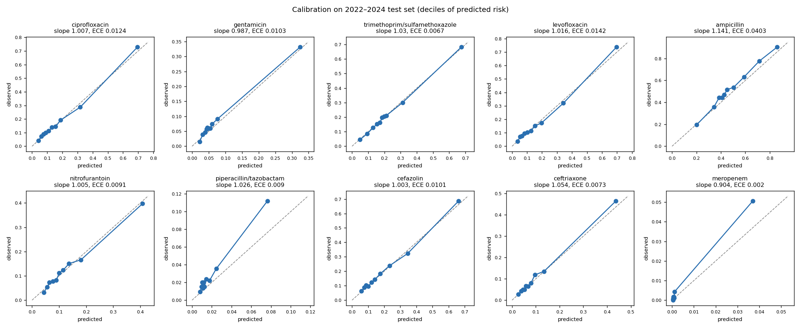

# Phase B: robust evaluation

Run 14 Oct 2026 on the frozen final model, 2022–2024 test set (317,134 culture × antibiotic rows, 28 antibiotics). Code: `src/05_evaluate.py`. Tables and plot: `reports/phaseB/`.

## Bottom line

- **Discrimination:** mean AUROC 0.780 (95% CI 0.772–0.787) across 28 antibiotics; 0.761 (0.754–0.769) for the top 10. CIs come from a 1,000-rep bootstrap that resamples patients, not rows.
- **Calibration:** good after per-antibiotic recalibration fitted on 2021: median ECE 0.012 (was 0.024), median slope 0.98 (was 1.21).
- **Performance decays over time:** mean AUROC is 0.803 in 2021, 0.789 in 2022 and 0.771 in 2023. Plan yearly retraining or recalibration.
- **Weaker groups:** blood cultures, ER and patients 85+ (AUROC 0.69–0.72). Calibration is fair across all groups.

## 1. Confidence intervals

Per-antibiotic AUROC with 95% CI: `reports/phaseB/bootstrap_auroc_ci.csv`.

## 2. Calibration

| | Before recalibration | After |
| --- | --- | --- |
| Median ECE (28 antibiotics) | 0.024 | **0.012** |
| Median calibration slope | 1.21 (too timid) | **0.98** |
| Mean Brier | 0.0964 | **0.0948** |
| Worst antibiotics | amp/sulbactam ECE 0.129, tetracycline 0.118 | penicillin 0.075 (slope 0.62), erythromycin 0.055 |

Recalibration is a logistic fit on logit(p) per antibiotic, using 2021 data only (`models/final_calibration.json`). It is monotonic, so AUROC is unchanged. Remaining issues: the top risk decile underpredicts for pip/tazo (observed 11% vs predicted 8%) and meropenem; penicillin is affected by drift (section 4).

## 3. Subgroups (test set; mean AUROC over antibiotics with ≥20 resistant and ≥20 susceptible rows)

| Attribute | Group | Rows | Resistant % | Observed − predicted (pp) | Mean AUROC |
| --- | --- | --- | --- | --- | --- |
| Culture | Urine | 271,302 | 12.8 | +0.4 | 0.746 |
| | Respiratory | 19,722 | 21.0 | −0.8 | 0.798 |
| | Blood | 26,110 | 18.2 | −0.2 | **0.692** |
| Ward | Outpatient | 143,453 | 12.5 | +0.1 | 0.801 |
| | Inpatient | 32,246 | 16.9 | +0.1 | 0.765 |
| | ICU | 16,456 | 19.9 | +0.8 | 0.726 |
| | ER | 117,630 | 13.6 | +0.5 | **0.706** |
| Age | 18–44 | 70,353 | 12.0 | +0.0 | 0.779 |
| | 45–64 | 73,434 | 14.5 | +0.6 | 0.775 |
| | 65–84 | 130,081 | 14.5 | +0.3 | 0.763 |
| | 85+ | 43,266 | 13.4 | +0.2 | **0.723** |
| Sex (anonymised code) | 0 | 242,508 | 12.4 | +0.3 | 0.769 |
| | 1 | 74,548 | 18.2 | +0.4 | 0.781 |
| Deprivation (ADI percentile) | 1–20 | 252,372 | 13.4 | +0.2 | 0.771 |
| | 21–40 | 14,428 | 17.0 | +0.4 | 0.764 |
| | 41–60 | 5,376 | 18.6 | +1.0 | 0.713 |
| | 61–80 | 2,210 | 19.6 | +0.5 | 0.706 (6 antibiotics) |
| | 81–100 | 396 | 26.0 | +1.3 | too few |
| Patient | Returning | 91,435 | 15.3 | +0.7 | 0.829 |
| | New | 225,699 | 13.1 | +0.1 | 0.748 |

Calibration-in-the-large is within ±1.3 points in every group. Discrimination falls as deprivation rises, but the more deprived groups are small; this is a fairness caveat to report. Most of the cohort lives in low-ADI areas.

## 4. Temporal drift

| Year | Rows | Resistant % | Predicted % | Mean AUROC |
| --- | --- | --- | --- | --- |
| 2021 (validation) | 140,359 | 14.1 | 14.1 | 0.803 |
| 2022 | 153,496 | 13.5 | 13.6 | 0.789 |
| 2023 | 160,292 | 14.0 | 13.4 | 0.771 |
| 2024 (Jan only) | 3,346 | 14.6 | 13.7 | 0.724 (8 antibiotics) |

- **The 2017 "drop" in resistance is a testing change, not biology.** Antibiotics tested per culture jumped from 11.7 (2016) to 15.3 (2017), while resistance on a fixed panel (cipro, TMP/SMX, nitrofurantoin, cefazolin, gentamicin) stayed at 16–17%. Adding mostly-susceptible drugs to the panel lowered the overall rate.
- **Penicillin testing became selective in 2022.** The number tested halved (2,005 in 2021 → 1,129 in 2022) and resistance rose from 30% to 47–54%. This explains its validation-to-test fall (0.911 → 0.757) and its residual miscalibration.
- **Recommendation:** refit the recalibration yearly, retrain every 1–2 years, and monitor panel changes.
