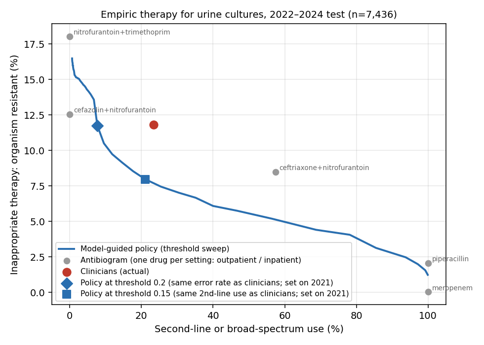

# Phase C: clinical decision analysis (empiric therapy for urine cultures)

Run 14 Oct 2026. Code: `src/06_decision_analysis.py`. Outputs: `reports/phaseC/`.

## Result

On 7,436 urine cultures from 2022–2024, a model-guided rule ("give the narrowest antibiotic whose predicted resistance risk is at or below a threshold") beats what clinicians actually prescribed. Both thresholds were fixed on 2021 data.

| | Inappropriate therapy (organism resistant) | Inappropriate (resistant or intermediate) | Second-line or broad use | Broad use (pip/tazo, meropenem) |
| --- | --- | --- | --- | --- |
| **Clinicians (actual)** | 11.8% | 14.4% | 23.3% | 1.5% |
| **Policy, threshold 0.20** (matches clinicians' error rate) | 11.8% (diff −0.1 pp, 95% CI −0.9 to +0.8) | 14.6% | **7.7% (−15.7 pp, −16.7 to −14.6)** | 2.7% |
| **Policy, threshold 0.15** (matches clinicians' second-line use) | **8.0% (−3.8 pp, −4.6 to −3.1)** | **10.8% (−3.7 pp, −4.5 to −2.9)** | 21.1% (−2.3 pp, −3.6 to −1.0) | 5.3% |
| Antibiogram, nitrofurantoin (outpatient) / cefazolin (inpatient) | 12.5% | — | 0% | 0% |

In short, the policy can either cut second-line prescribing by two thirds at the same error rate, or cut mismatched therapy by a third (11.8% → 8.0%) at the same second-line use. The trade-off is more broad-spectrum use (1.5% → 2.7–5.3%) for the patients the model flags as high risk.

**Outpatients only** (n = 3,166): clinicians had 11.8% inappropriate therapy with 16.5% second-line use. The policy at 0.20 gets 8.8% with 2.6%, better on both at once.

## Drug mix (test)

| Drug | Clinicians | Policy 0.20 | Policy 0.15 |
| --- | --- | --- | --- |
| Nitrofurantoin | 36.7% | 38.8% | 36.3% |
| Cefazolin / cephalexin | 30.6% | 17.2% | 29.3% |
| TMP/SMX | 9.4% | 36.3% | 13.4% |
| Ciprofloxacin / levofloxacin | 13.2% | 2.4% | 5.8% |
| Ceftriaxone / cefpodoxime / cefdinir | 8.6% | 2.6% | 10.0% |
| Pip/tazo | 1.5% | 2.6% | 5.1% |
| Meropenem | 0% | 0.1% | 0.2% |

## Method

- **Candidates, narrow → broad:** nitrofurantoin, TMP/SMX, cefazolin (first-line); ciprofloxacin, ceftriaxone (second-line); pip/tazo, meropenem (broad).
- **Constraint:** nitrofurantoin is not offered for inpatient cultures (pyelonephritis/bacteraemia). This handicaps the policy: clinicians gave nitrofurantoin in 27.7% of inpatient cultures.
- **Clinician choice:** the systemic candidate drug recorded on the day of the culture order (`prior_med`, day 0). Oral drugs are mapped to the susceptibility result that stands in for them: cephalexin/cefadroxil → cefazolin, cefpodoxime/cefdinir → ceftriaxone, levofloxacin/ofloxacin → ciprofloxacin.
- **Cohort:** urine cultures with results for all 7 candidates (15,188 of 17,086) and exactly one clinician candidate drug (7,436).
- **Thresholds:** chosen on 2021 (n = 2,929) to match clinicians' inappropriate rate (0.20) or second-line rate (0.15). CIs come from 2,000 paired bootstrap resamples of cultures.

## Limitations

- **Retrospective counterfactual:** it assumes the susceptibility result decides treatment success. It ignores allergies, pregnancy, renal function, drug interactions and whether the infection was real (asymptomatic bacteriuria).
- **Selection:** only cultures where all 7 drugs were tested and the clinician gave exactly one candidate drug. Patients with no antibiotic, or with two, are excluded.
- **Timing:** same-day medications can include drugs started before the culture for another reason.
- **Surrogate mappings** (cephalexin → cefazolin) follow common practice but are imperfect.
