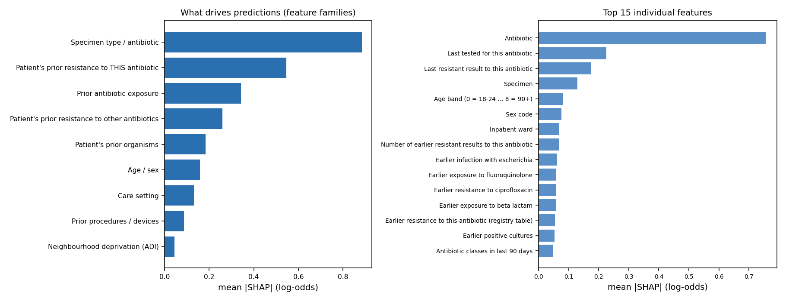

# Phase D: explainability

Run 14 Oct 2026. Code: `src/predictor.py` (frozen model plus `explain()`), `src/07_explain.py`. Outputs: `reports/phaseD/`.
Method: TreeSHAP contributions from LightGBM (`pred_contrib`), averaged over the two ensemble components and scaled by each antibiotic's calibration slope. Computed on 10,000 random test rows.

**Checks:** the predictor reproduces the frozen test predictions exactly (max difference 0.0), and SHAP values sum to the model's log-odds (max error 8e-12).

## What drives the predictions

1. **Which antibiotic and specimen** set the baseline risk. This is the antibiogram, which the model learns.
2. **The patient's own history with this antibiotic** is the strongest patient-specific signal. Risk falls steadily with time since the last resistant result:

| Last resistant result to the same antibiotic | Rows | Resistant % | Mean SHAP (log-odds) |
| --- | --- | --- | --- |
| 3–30 days | 84 | 88% | +1.53 |
| 31–90 days | 173 | 71% | +1.30 |
| 91–180 days | 143 | 67% | +1.06 |
| 181–365 days | 143 | 56% | +0.80 |
| 1–2 years | 145 | 39% | +0.46 |
| 2–5 years | 212 | 26% | +0.08 |
| > 5 years | 156 | 14% | −0.04 |
| Never resistant | 8,944 | 10% | −0.12 |

3. **Earlier exposure to fluoroquinolones and beta-lactams**, prior E. coli infections, and prior resistance to related drugs.
4. **Being tested recently without resistance lowers risk.** This is why "last tested for this antibiotic" ranks second overall.
5. **Neighbourhood deprivation contributes least** (0.04 log-odds), which is reassuring for fairness.

Per-antibiotic top 5 features: `reports/phaseD/top_features_by_antibiotic.csv`.

## Worked cases

`reports/phaseD/example_cases.md` shows three cases with their top six reasons:
- **Correct high-risk call:** penicillin, 98%, driven by resistance 117 days earlier and 27 prior resistant results.
- **Correct low-risk call:** ciprofloxacin, 2%, after a recent test that showed no resistance.
- **Missed resistance:** ciprofloxacin, 3.5%, a patient with no resistance history. History-driven models can't flag a first resistant infection, and the report says so.

## Caveat

Ensemble explanations are approximate: the average of the components' SHAP values in log-odds, while the ensemble averages probabilities. Each component's explanation is exact. The demo uses the same `explain()` call.
